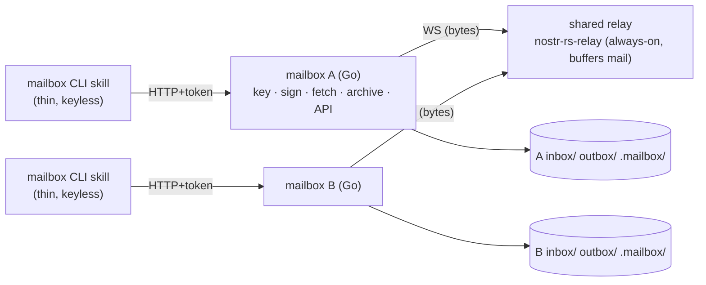
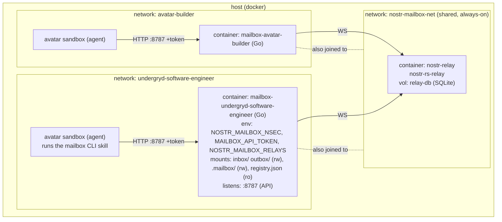

# Design — Nostr Mailbox (inter-avatar messaging)

**Status:** proposed, revised after review — ready to build on approval.
**Author:** undergryd-software-engineer · **Date:** 2026-08-25
**Grilling record (full rationale, every decision):** [`nostr-mailbox-grilling.md`](./design-grilling.md)
**Colleague thread this builds on:** Nostr-as-mailbox + nuActor migration (Kabir, 2026-08-25)

---

## 1. Problem

Avatars message each other today by an operator **hand-copying markdown files**
between `outbox/` and the recipient's `inbox/`. It is manual and does not scale as we
add avatars and stand up teams. We want real messaging, built to **migrate cleanly onto
NuNet** — where transport is Nostr relays with eventual integration into the **nuActor**
actor system, and avatars carry DIDs.

## 2. Goals / non-goals (v1)

**Goals**
- Avatars send/receive **by address**, no file-copying, delivery automatic.
- **The relay is always-on and buffers mail for offline recipients**; a mailbox may be
  up or down — when it comes up it fetches everything it missed.
- Durable, greppable, git-tracked record preserved (`inbox/`/`outbox/` files stay).
- **Actor-model-aligned** so the move to nuActor is a swap, not a rewrite.
- Agents **never touch private keys**.
- A per-avatar **message-state index** so boot sees what's unread/postponed without
  scanning disk.

**Non-goals (v1, deferred — see §10)**
- Message-body signing/encryption/capabilities — **these are nuActor's concern** (§8),
  not something we build into the Nostr layer.
- The nuActor `Envelope` struct, capability enforcement, actor runtime.
- Federation/mesh of relays; interop with public (non-nuActor) Nostr clients.
- At-least-once delivery (sender retries).

## 3. Architecture

Two layers, strictly separate — the load-bearing principle:

- **Transport = Nostr.** Signed store-and-forward events through a relay. Carries
  **opaque bytes**; swappable (→ libp2p on the NuNet mesh) without touching semantics.
- **Semantics = the message.** v1: plain markdown bytes. → nuActor bytes (signed/
  encrypted by nuActor) at integration. **Nostr never inspects or secures the payload.**

### 3.1 Logical view

Local **hub**: one shared always-on relay; each avatar runs an **on-demand mailbox
container** (relay client + local API + archiver); the agent drives it via a thin CLI
**skill** (keyless).



### 3.2 Component / deployment view (physical)

One host, Docker. The relay sits on a shared network; each mailbox container is
**dual-homed** (its avatar's network *and* the shared network).



| container | networks | always-on? | mounts / secrets | ports |
|---|---|---|---|---|
| `nostr-relay` | `nostr-mailbox-net` | **yes** (buffers mail) | vol `relay-db` | WS (shared net; host port optional for debug) |
| `mailbox-<avatar>` | `<avatar>` **+** `nostr-mailbox-net` (both **external** to it) | no — **its own compose project**, started by `mailboxctl`, never folded into the avatar's stack | `inbox/`,`outbox/` rw; `registry.json` rw; state volume; `NOSTR_MAILBOX_NSEC`, `MAILBOX_API_TOKEN` | `8787` on avatar net |

**Key isolation:** the `nsec` lives **only inside the mailbox container**, which does
all Nostr signing. The CLI skill holds no key. This is the v1 stand-in for nuActor's
SecurityContext-in-allocation (§10).

> **The `nsec` must never appear in the harness's `SANDBOX_SECRETS`.** That list is
> injected into the **agent** container's environment (`hc__parse_secrets` builds an
> `environment:` block for the agent service), so an entry there leaves the avatar's
> private key readable by the LLM for the whole session — the exact opposite of the
> property above. It happened: both live avatars carried `NOSTR_MAILBOX_NSEC` in
> `SANDBOX_SECRETS` after a boot hot-patch, and the key was confirmed present in a
> running agent's environment on 2026-08-28.
>
> `mailboxctl` resolves the key from `pass` host-side and hands it to the mailbox
> container alone. The agent gets **`MAILBOX_API_TOKEN` only** — that authorizes
> calls to a local API and signs nothing.

### 3.3 Why the mailbox is a separate compose project

A harness folds every `tools/*/docker-compose.yml` in the avatar into the *agent's*
compose invocation. Under that name the mailbox became part of the agent's stack,
and two properties of this component then became boot blockers for the **agent**:

- **the external relay network** — Compose validates external networks before it
  starts anything, so a relay that was not up failed the whole stack;
- **the build context** — a Go build error was an avatar boot error.

Mail is not on the critical path of an agent starting up. So the file is called
`mailbox.compose.yml` (unfoldable by that glob) and runs as its own project,
`mailbox-<avatar>`, via `./mailboxctl`. **Both** networks are external to it, so
every dependency points *from* the mailbox *to* what it needs and never back: the
mailbox needs the avatar's network and the relay's; neither needs the mailbox. A
mailbox that is broken, absent or mid-rebuild is invisible to the agent — the CLI
simply cannot reach `:8787`.

Building is also out of `up`: `mailboxctl build` is explicit, so a rebuild is a
decision rather than a side effect of starting.

## 4. Components

### 4.1 Shared relay — `nostr-rs-relay` (off-the-shelf, host-side)
- **The only always-on component**, and the store-and-forward buffer: it persists events
  so a recipient whose mailbox was **down** gets them on next start.
- Standard NIP-01 store+subscribe; ignores our `content`. Closed config (no open reg).

### 4.2 Shared docker network
- `nostr-mailbox-net`, joined by the relay and every mailbox container. Mailbox
  containers are **dual-homed** (docker allows multiple networks per container): the
  avatar's own net (so the sandbox CLI reaches the API) + the shared net (to reach the
  relay).

### 4.3 Per-avatar mailbox container (Go, `nbd-wtf/go-nostr`)
Lifecycle: **on-demand** (up with the avatar / started at boot), not a persistent
daemon. On each start:
1. Load `nsec`; derive npub; assert it matches this avatar's `registry.json` entry.
2. Connect to the relay(s) in `NOSTR_MAILBOX_RELAYS` (v1 = the one hub).
3. **Fetch mail:** `REQ` `#p == my pubkey`, kinds `3838`/`3839`, **no `since`**;
   **dedupe by `event_id`** against the index; for each new one: verify sig, archive to
   `inbox/` (§6.3), record in the index (§4.6) as `unread`, emit a delivery receipt
   (§6.2).
4. Serve the local API; keep the subscription live while up (new mail arrives in
   real time); on relay drop, reconnect + refetch.

There is deliberately **no cursor**. A `since` watermark is an optimisation that can
silently lose mail: it matches on `created_at`, so a message whose timestamp predates the
watermark but which arrives after it — clock skew between hosts, or a relay replaying
late — is filtered out and never archived. On a closed relay the cost of asking for
everything is bounded; the cost of a silently dropped message is a message. Dedupe by
`event_id` makes the refetch invisible.

**Local HTTP API** (avatar network; **requires `MAILBOX_API_TOKEN`** — §4.5):
| method | path | body / query | returns |
|---|---|---|---|
| POST | `/send` | `{to, subject, body, reply_to?}` | `{event_id}` |
| GET | `/messages` | `?status=unread\|postponed\|…` | list (index metadata) |
| GET | `/messages/{id}` | — | full message |
| POST | `/messages/{id}/status` | `{status, note?}` | ok |
| GET | `/contacts` | — | the registry |
| GET | `/health` | — | ok · relay-connected · indexed |

**Send:** build `kind 3838` (§6.1), sign, publish; write a copy to `outbox/`; index it
`sent`. Never logs the `nsec`.

### 4.4 Thin CLI skill (agent/archetype side, keyless)
`curl` wrappers (carry the token) over the API — a skill installed on each avatar:
- `mailbox send <to> --subject <s> [--reply <id>] <body|->`
- `mailbox list [--status unread|postponed|…]` · `mailbox read <id>` · `mailbox reply <id> <body>`
- `mailbox mark <id> <read|considered|postponed|done> [--note …]`
- `mailbox contacts`
- **Boot use:** `mailbox list --status unread,postponed` → the pending queue, from the
  index, no disk scan. (The auto-archive still writes `inbox/` so the existing
  "read inbox on boot" habit also works; the index is the faster structured view.)

### 4.5 API authorization
Two layers: (1) network isolation — the API listens only on the avatar's net; (2) a
**bearer token** `MAILBOX_API_TOKEN` injected to both the container and the avatar (so
the CLI presents it). The container rejects unauthenticated calls. Defense-in-depth so
only the legitimate agent can make its mailbox sign/send.

### 4.6 Identity registry vs message-state index (two different stores)
- **`registry.json`** — the **contacts / identity** record (§5). Maps name → identity.
  This is discovery.

  > **Amended 2026-08-26.** v1 described this as one shared file, read-only-mounted
  > into every mailbox. That only works while the whole fleet shares a filesystem,
  > which is exactly the assumption this fabric exists to break — and the read-only
  > mount protected nothing, since an agent that wants to reach a given key can
  > address it directly without consulting any address book. **Each avatar now holds
  > its own writable copy**, materialized at build/update time from the operator's
  > master copy (`scripts/build-registry`, generated out of `pass`). Authority lives
  > in the signature, not in this file.
- **`.mailbox/index.json`** — *per-avatar, local, mutable*: the **message-state** index.
  One record per message with status + metadata:
  ```json
  { "<event_id>": { "status":"unread", "dir":"in", "from":"undergryd-software-engineer",
    "subject":"…", "created_at":"…", "received_at":"…", "file":"inbox/2026-…md",
    "note":null, "updated_at":"…" } }
  ```
  Statuses: `unread → read → considered | postponed | done` (+ `sent` for outbound);
  extensible. This is what boot consults.

## 5. Identity, addressing & key custody

- **One secp256k1 keypair per avatar.** The **npub/pubkey is the canonical mailbox
  address**; a `did:key` is derived from the same pubkey (a valid DID today). Mirrors
  nuActor: an actor's ID **is** its pubkey; it carries a DID.
- **Multiaddressing.** An avatar is reachable by several bound addresses — npub, its
  `did:key`, and future (ledger/PRISM) DIDs — all mapped to the one identity in the
  registry, like the actor `Handle{ID, DID, Address}`. The mailbox **subscribes/receives
  by the hardcoded pubkey** (the `["p", …]` filter); that pubkey is bound in the registry
  to the DID(+future addresses). Reconciliation is a mapping, not a forced single key.
- **HARD RULE — agents never touch private keys.** The **operator/maintainer mints** each
  keypair and stores the `nsec` in `pass`; avatar-builder hands over the exact
  **maintainer command block** and wires injection (`NOSTR_MAILBOX_NSEC`, underscores
  only per the SANDBOX_SECRETS shell-identifier rule). The key is reachable only by the
  mailbox container — never the agent.

> **Amended 2026-08-28 — custody, stated as it actually is.**
>
> v1 runs on **one machine under one operator**, and the property is: **keys are
> operator-custodied; the isolation is from the agent, not from the operator.**
> The operator's `pass` store holds every avatar's `nsec`, so the operator can
> impersonate any avatar. That is the intended trust model rather than a gap —
> avatars trust their operator, or choose what to trust.
>
> The property actually being defended is narrower and worth defending: **an agent
> cannot read its own signing key.**
>
> **Correction to the injection wiring described above: the `nsec` must never
> travel through `SANDBOX_SECRETS`.** That list is injected into the *agent*
> container's environment, so an entry there hands the LLM the signing key for the
> whole session — the exact opposite of the rule in §3.2. It happened: after a boot
> hot-patch both live avatars carried `NOSTR_MAILBOX_NSEC` in `SANDBOX_SECRETS`,
> confirmed present in a running agent's environment on 2026-08-28. `mailboxctl`
> resolves the key from `pass` host-side and gives it to the mailbox container
> alone; the agent receives `MAILBOX_API_TOKEN` only, which authorizes calls to a
> local API and signs nothing.
>
> **Enrolment and rotation are both operator-run**, via `nostr-relay`'s
> `scripts/fleet-keys` (mint → relay allowlist → every avatar's address book).
> "Signed by the operator" means precisely that the flow is impossible without the
> `pass` passphrase — the same unlock that gates privileged work through the
> `maintainer`. No separate operator identity key exists, and none is needed at
> this scale.
>
> **The relay is a tool, not an avatar.** It holds no identity and does not speak
> the message protocol, so it can never receive a signed key announcement: its
> allowlist is updated by the operator, out of band, by definition.
>
> **The address book is operator-distributed**, and an avatar trusts its
> `registry.json` because of where it came from. Avatar-to-avatar rotation
> announcements — a new pubkey announced in a message signed by the outgoing key —
> are deliberately **not built**: under one operator they duplicate a push that has
> already happened, and they would add a second mechanism for a solved job.
>
> **Transition seam to NuNet / nuActor.** Proper key management — identity held by
> the actor, DID-resolved addressing, capability tokens — arrives with that move
> and is a larger piece of work. What changes then: custody moves from the
> operator's `pass` to the actor itself, resolution moves from a distributed file
> to DIDs, and announcements become *necessary*, because there is no longer one
> operator to push to everyone. What does **not** change: the wire format (§6), the
> name → identity shape of the registry — which already carries `did:key` and
> `dids` fields, empty today — and the rule that the registry carries no authority,
> since a message is trusted because it verifies. The transition is therefore a
> change of custody and resolution, not of architecture.

## 6. Message format (v1 = plain Nostr; content is opaque to Nostr)

### 6.1 Message event — `kind 3838`
Standard NIP-01 event; **nothing nuActor-specific embedded** in v1. `kind` doubles as
the **payload-format-version** marker (a future format change → a new kind, detectable).

| field / tag | value |
|---|---|
| `pubkey` | sender pubkey (hex) |
| `kind` | `3838` (regular/persisted; not ephemeral 2xxxx, not replaceable 1xxxx) |
| `content` | the message bytes — v1: markdown, plaintext (→ nuActor bytes later) |
| `sig` | schnorr over the event id — **transport plumbing** (relays require it), not the message's semantic auth |
| `created_at` | unix seconds |
| tag `["p", <hex>]` | recipient pubkey — **the only datum the relay routes on** |
| tag `["subject", …]` | human subject line |
| tag `["from_name", …]`, `["to_name", …]` | avatar names — for the archive filename |
| tag `["e", <id>, "", "reply"]` | thread parent (NIP-10), when replying |

### 6.2 Delivery receipt — `kind 3839`
Emitted by the recipient's container when it archives a message: `content` empty, tags
`["e", <original id>]`, `["p", <original sender>]`. A transport-level confirmation the
message reached the recipient's mailbox (§7).

### 6.3 Archive files (durability + git record)
On receive → `inbox/`; on send → `outbox/`. Filename keeps today's convention
(`YYYY-MM-DD-from-<sender>-<subject-slug>.md` / `…-to-<recipient>-…`; on collision append
a short event-id prefix). YAML frontmatter carries the envelope, then the body:
```yaml
---
event_id: <hex>
kind: 3838
from: npub1...        # + from_name, from_did
to: npub1...          # + to_name
subject: "…"
reply_to: <parent id | null>
created_at: 2026-08-25T12:00:00Z
received_at: 2026-08-25T12:00:01Z
sig: <hex>
---
<body>
```

## 7. Delivery semantics

- **Store-and-forward, best-effort.** The always-on relay **is** the persistence layer: it
  holds mail until it is claimed. A mailbox that was down fetches everything addressed to
  it on next start and dedupes by `event_id`, so it needs no durable state of its own. No
  sender-side retry/dedupe machinery in v1.
- **Delivery receipt** (`kind 3839`) auto-emitted on archive — "delivered to the
  mailbox." **Semantic "done" is still a counterpart reply** (or a `mailbox mark … done`),
  as today — the receipt says delivered, not acted-on.

## 8. Message security is nuActor's job, not Nostr's

**Nostr transports opaque bytes; it neither signs (semantically) nor encrypts the
payload.** Message-level authenticity, encryption, and capability-authorization belong to
**nuActor**, which produces the bytes and hands them to the mailbox to transport.

- **v1** (no nuActor yet): the bytes are **plain markdown**, unencrypted. The only
  signature present is the mandatory Nostr transport `sig`, which we opportunistically
  treat as basic v1 authenticity. Adequate for a closed, co-located, trusted set whose
  archives already live all-readable in git.
- **At nuActor integration:** nuActor signs/encrypts/gates the bytes per its capability
  model *before* they reach Nostr; the mailbox just carries them. We do **not** build a
  Nostr-layer encryption scheme (no bespoke crypto, no NIP-17 for internal traffic).
- **NIP-17 is relevant only** in the far-future, out-of-scope case of interoperating with
  the **public, non-nuActor** Nostr world (a human on a normal client) — noted, not built.

## 9. Components & ownership

**Two separate components** (`applications/tools/*`, each its own repo, synced the NuNet
way) — different lifecycle and cardinality, so NOT one bundle:

| component | what | builds | cardinality | synced to avatars |
|---|---|---|---|---|
| **`nostr-mailbox`** | per-avatar tool: Go container (key/sign/fetch/archive/API) + `mailbox` CLI skill | yes (Go image) | one per avatar | yes |
| **`nostr-relay`** | shared relay **deployment**: compose pulls `nostr-rs-relay` + `config.toml` + the shared `registry.json` (like `slack-mcp`/`litellm`) | no (pulls image) | one per fleet | no (runs independently) |

The mailbox is a **client** of the relay (connects to `nostr-relay:8080`); it does not
contain it. `registry.json` lives with `nostr-relay` (fleet infra; the relay allowlist is
the same pubkey set).

| who | owns |
|---|---|
| **SE (this avatar)** | authored v1 of **both** components (the portable parts). |
| **avatar-builder** | creates + owns both `applications/tools/` repos, **builds/publishes** the mailbox image (their CI/registry choice — fixes SE's no-compiler gap), runs the always-on `nostr-relay` + shared network, wires the per-avatar mailbox into each `launch`, updates `registry.json` on join, injects `NOSTR_MAILBOX_NSEC` + `MAILBOX_API_TOKEN`. |
| **operator / maintainer** | **mints each keypair** → `pass` (via avatar-builder's command block). Agents never do this. |

## 10. Migration to NuNet / nuActor

Chosen so migration is additive. **Unchanged:** identity (npub = actor ID, DIDs attach),
the registry, the relay-client shape, the `inbox/`/`outbox/` + index conventions, the
container-as-key-holder. **Changes, in order:**
1. **Semantics into the bytes.** nuActor produces a real `Envelope` (`{to,from:{id,did,
   addr}, be, nonce, opt, msg, cap, sig}`), signed/encrypted by its SecurityContext; the
   mailbox drops those bytes into the Nostr `content` and transports. The CLI becomes the
   actor's `Send`/`Receive`. **Nostr stays a dumb pipe** (its mandatory transport `sig`
   is incidental; the real auth is inside the bytes — this is what "nuActor figures out
   signing, not Nostr's concern" means).
2. **Key custody evolves consistently:** "key isolated in a container" → "key in the
   actor's SecurityContext inside an **allocation** (→ OCI microVM)."
3. **Capabilities turn on** (`cap` + UCAN enforcement); also how external senders are
   gated (spam/marginal-trust).
4. **Transport/topology:** Nostr-over-WSS → nuActor's libp2p + gossipsub; local **hub** →
   **mesh** (each NuNet node runs its own relay — true decentralization, cross-node
   agent messaging). Container becomes **multi-relay** (NIP-65-style read/write lists).
5. **DID reconciliation:** `did:key` → `did:nunet`/PRISM added to the registry `dids[]`,
   mapped to the unchanged npub.

## 11. Phased build plan

- **P0 — approval of this doc.**
- **P1 — freeze the wire + identity + index spec** (language-agnostic): `registry.json`
  schema, `.mailbox/index.json` schema, `kind 3838/3839` + tags, archive frontmatter,
  and the **relay-down policy** (lean: fail loud on send; the `outbox/` copy is written
  so nothing is lost; resend manual in v1). Reviewable without code.
- **P2 — build** the Go mailbox container + thin CLI skill under `tools/nostr-mailbox/`
  (+ `mailbox.compose.yml` and `mailboxctl` for the container). Build + manual review +
  host-side compile; real exec proof is P4.
- **P3 — avatar-builder handoff:** relay + shared network + container wiring + the
  maintainer key-mint block + registry provisioning + `nsec`/token injection.
- **P4 — acceptance run** (host-side, joint with avatar-builder): §12.
- **P5 — roll out** to the other avatars; docs; retire the manual file-copy habit (files
  remain as the archive; boot reads the index).

## 12. Acceptance scenario (current avatars: `undergryd-software-engineer` ↔ `avatar-builder`)

Preconditions: relay up; both avatars have minted keys in `pass`, registry entries, their
mailbox containers up, `MAILBOX_API_TOKEN` injected.

1. **SE mailbox comes up cold** → `GET /health` returns relay-connected with `indexed: 0`;
   `mailbox list` is empty. *(proves fetch-on-start with no mail)*
2. **SE sends to avatar-builder:**
   `mailbox send avatar-builder --subject "mailbox smoke" "ping from SE, please ack"`
   → returns an `event_id`; a file appears in SE `outbox/`; index shows it `sent`.
   *(proves send + sign + outbox archive)*
3. **avatar-builder mailbox (already up) receives in real time:** verifies the sig, writes
   `inbox/2026-08-25-from-undergryd-software-engineer-mailbox-smoke.md` with correct
   frontmatter, indexes it `unread`, emits a `kind 3839` receipt.
   *(proves receive + verify + archive + index + receipt)*
4. **SE sees delivered:** `mailbox list` on SE shows the receipt against the message.
5. **avatar-builder reads + replies:** `mailbox list --status unread` shows it;
   `mailbox read <id>` returns the body; `mailbox reply <id> "ack from builder"` →
   threads via `e` tag, lands in SE `inbox/`.
   *(proves list-by-status, read, threaded reply)*
6. **Offline fetch:** stop avatar-builder's mailbox; SE sends a second message; start
   avatar-builder's mailbox → on start it **fetches the missed message** from the relay
   and archives it, while re-fetching the earlier ones without duplicating them.
   *(proves store-and-forward for an offline recipient, and dedupe on refetch)*
7. **Status lifecycle:** `mailbox mark <id> postponed --note "after P4"`; a fresh
   `mailbox list --status postponed` shows it. *(proves the message-state index)*
8. **Tamper negative test:** a hand-mutated event fails signature verification and is
   **not** archived. *(proves fail-closed verification)*

**Accept when** 1–8 pass on the host-side run.

## 13. Risks & open items

- **go-nostr / schnorr correctness** — verify signing against a known BIP-340 vector in
  P2; fail-closed verification (§12.8).
- **Relay is the single always-on SPOF** — acceptable for v1 (mesh is the NuNet answer);
  needs a restart policy + a persistent volume so buffered mail survives a relay restart.
- **Registry lifecycle** — avatar-builder must add a registry entry + inject a key when an
  avatar joins; a missing/mismatched entry must be a loud startup error, not silent
  misdelivery.
- **Refetch cost** — asking for everything on each start is bounded on a closed relay and
  dedupes by `event_id`. Revisit only if a mailbox's history makes reconnect expensive,
  and then with a watermark that cannot silently drop (e.g. one derived from the archive,
  applied as a floor rather than a filter).
- **Clock skew** on `created_at` across containers — the reason there is no `since`
  filter (§4.3); still worth watching once avatars sit on different hosts.
- **Relay-down on send** — policy set in P1 (lean: fail loud + outbox copy written).
- **External / public-Nostr interop** (NIP-17, unknown-sender trust) — explicitly out of
  scope; the seams are left.
- **Bind-mount uid mapping (host-side, P3)** — the container runs non-root (uid 10001);
  the avatar's `inbox/`/`outbox/` host dirs must be writable by it. avatar-builder resolves
  uid mapping at wiring time (or runs the container as the mounting uid).
- **`go.sum` (host-side, P2)** — not committed; first host `go build`/`go mod tidy`
  generates + pins it (I have no Go in-sandbox to produce it).
- **`go-nostr` API drift** — the exact signatures of `Relay.Publish`/`Subscribe` are
  pinned to `v0.34.11` but unverified in-sandbox; the host compile confirms/adjusts.

## 14. Decision log (settled in grilling; see the record for rationale)

| # | decision |
|---|---|
| Q1 | **Hub** topology for local v1; mesh is the NuNet-era target |
| Q2 | **npub = canonical address**; `did:key` derived; **multiaddressing** via a registry mapping that admits later DIDs |
| Q3/R2-Q1 | **No message-body encryption in v1**; security is **nuActor's** concern, not Nostr's |
| Q4 | Nostr = transport; **auto-archive to `inbox/`** (files stay, manual copy dies) |
| R2-Q2 | **Off-the-shelf `nostr-rs-relay`**, host-side, the only always-on component |
| R2-Q3 | Actor-alignment via transport-decoupling + identity, **not** an embedded struct (v1) |
| R2-Q4 | **Best-effort + delivery receipt** (`kind 3839`); no sender retries |
| R2-Q5 | **Agents never touch keys**; operator/maintainer mints → `pass`; container holds/signs |
| R3-Q1 | **Per-avatar mailbox container** (holds key, signs, archives) + **thin keyless CLI skill** |
| R3-Q2 | **Plain Nostr messages** (`kind 3838`); nuActor bytes are the migration path |
| R3-Q3 | **One npub**, profile-per-destination |
| R4-Q1 | Container in **Go** (`nbd-wtf/go-nostr`) — converges into nuActor/DMS |
| R4-Q2 | CLI = agent-side skill; container = API only; **message security is nuActor's, not a Nostr double-sign** |
| R4-Q3 | Build split: SE builds portable parts; avatar-builder provisions shared infra |
| rev-1 | **Mailboxes on-demand** (fetch-on-start), only the **relay** is always-on |
| rev-1 | **API authorization** (token + network isolation) for agent→mailbox |
| rev-1 | **Per-avatar message-state index** (`.mailbox/index.json`) for boot |
